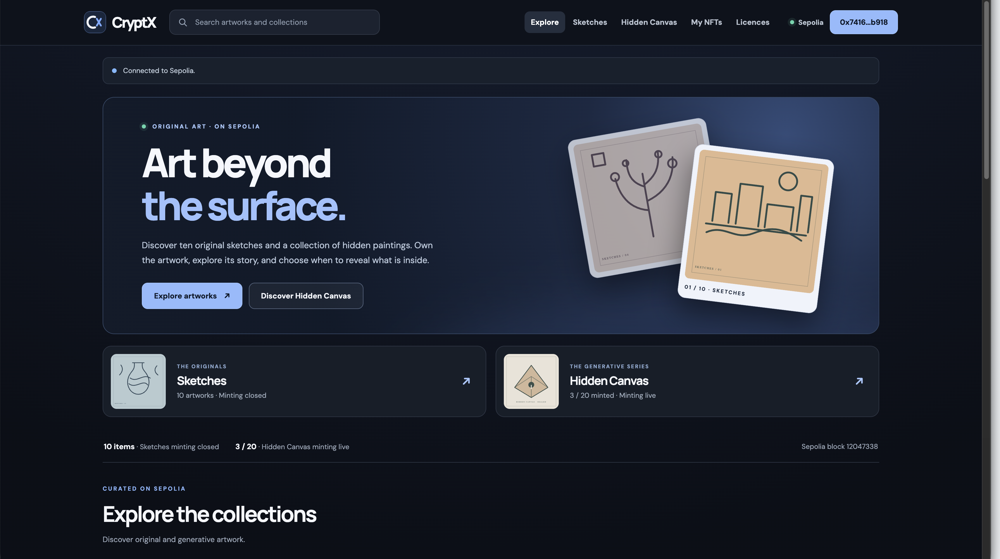
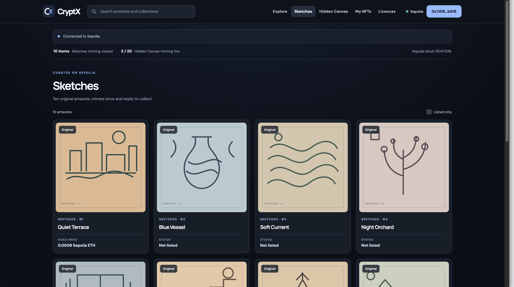
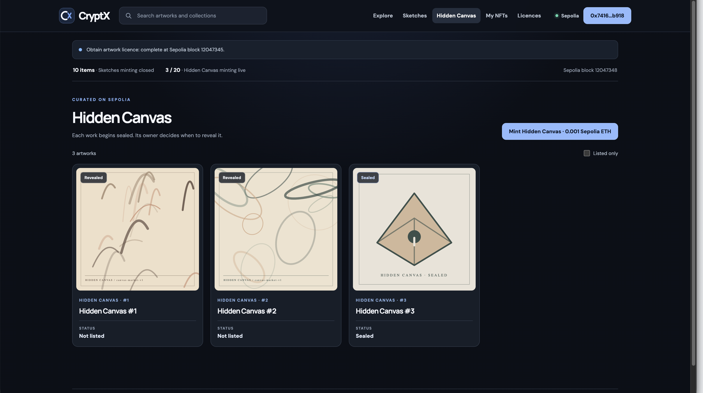

# CryptX

CryptX is a decentralized NFT marketplace on **Ethereum Sepolia** (chain ID `11155111`). Its Solidity contracts hold NFT ownership, sale listings, licence receipts and encrypted-artwork state. The React frontend uses ethers.js to read contract data and MetaMask to request signed transactions. The site has no account database or project-held wallet key.

## Features

- **Sketches:** ten fixed ERC-721 artworks minted to the deployer when the collection is created.
- **Hidden Canvas:** up to twenty paid ERC-721 mints. Each NFT starts with a Zama-encrypted random seed. After a 96-block wait, its current owner can privately preview the deterministic painting.
- **Public reveal:** the owner authorizes permanent public decryption, then a second transaction verifies the public proof and publishes the artwork and traits.
- **Marketplace:** owners list NFTs for a fixed Sepolia ETH price; buyers purchase through MetaMask and sellers withdraw proceeds.
- **Artwork licences:** users pay a fixed fee for a non-transferable receipt tied to an artwork hash. This does not transfer NFT ownership.

The interface lets users **connect MetaMask, call contract functions, and view returned on-chain data**, including owners, listings, publication state, licences and balances.

## Technology

Solidity 0.8.27, Hardhat, OpenZeppelin ERC-721, Zama FHE, React, TypeScript, Vite, ethers.js and MetaMask. The frontend reads Sepolia through a public RPC. MetaMask keeps private keys outside this repository; no `.env` file or paid Sepolia API key is required for the existing deployment.

## Existing Sepolia deployment

These contracts are **already deployed**. Cloning the repository and starting the frontend does not deploy or mint anything.

| Contract | Address |
| --- | --- |
| Sketches NFT | [`0xE98bEd0943A1fc22296E1bBfafca30660a3b6508`](https://sepolia.etherscan.io/address/0xE98bEd0943A1fc22296E1bBfafca30660a3b6508) |
| Hidden Canvas NFT | [`0x8a2d41319C8bF12Cc86a10C2499d195a9dF47a84`](https://sepolia.etherscan.io/address/0x8a2d41319C8bF12Cc86a10C2499d195a9dF47a84) |
| NFT Marketplace | [`0xc6209DBeF278159DAeb383414C34266D65ec1252`](https://sepolia.etherscan.io/address/0xc6209DBeF278159DAeb383414C34266D65ec1252) |
| Artwork Licensing | [`0x8a465728f97EEc5062Ed57E46B5659Cfbd7d9E13`](https://sepolia.etherscan.io/address/0x8a465728f97EEc5062Ed57E46B5659Cfbd7d9E13) |

The public addresses and deployment transaction hashes are in [`deployments/sepolia-marketplace.json`](deployments/sepolia-marketplace.json). Keep that file when copying the project.

## Run the frontend

Install Node.js **22.23.3** and npm 10. On macOS/Linux, `nvm` can select the pinned version. From the project root:

```sh
nvm install 22.23.3
nvm use 22.23.3
npm ci
npm --prefix frontend ci
npm run compile
npm --prefix frontend run dev
```

Open **http://127.0.0.1:5173/**. Public artwork and blockchain data can be viewed without a wallet. For signed actions, install MetaMask, select **Sepolia**, connect it in CryptX and use faucet-funded test ETH. Press **Ctrl+C** in the server Terminal to stop the site. On later runs, `nvm use 22.23.3` and `npm --prefix frontend run dev` are enough while dependencies and compiled artifacts remain installed.

Port `5173` matters: the deployed Sketches metadata and sealed-art placeholder contain local `127.0.0.1:5173` URLs. The website runs on your computer; those URLs are not public hosting and may not display on third-party NFT marketplaces.

## Deploy the smart contracts yourself (optional new deployment)

The addresses above are ready to use. To create a **separate** Sepolia deployment, work in a separate copy of this project so the current manifest remains safe:

1. Install dependencies and compile with the first five commands under **Run the frontend**; stop before the `npm --prefix frontend run dev` command.
2. In that separate copy, remove `deployments/sepolia-marketplace.json` before starting `npm --prefix frontend run dev`. Use a fresh browser profile or clear this site's local storage so it does not load the old manifest.
3. Open `http://127.0.0.1:5173/`, connect a MetaMask account on Sepolia and fund it with enough **testnet ETH** for deployment gas.
4. Click **Deploy project with MetaMask**. Confirm the six transactions in order: deploy Sketches, deploy Hidden Canvas, deploy Marketplace, deploy Licensing, link Sketches, and link Hidden Canvas. The Sketches constructor mints all ten tokens to the deployer. The Hidden Canvas constructor fixes the 96-block preview delay and `0.001` Sepolia ETH mint price; licensing is `0.0001` Sepolia ETH.
5. Download the new public deployment manifest from the page and save it as `deployments/sepolia-marketplace.json` in that separate copy. Restart the frontend to bundle those new addresses.

The frontend deploys through MetaMask, so **do not export a private key into this repository**. A new deployment is permanent on Sepolia and costs testnet gas. It does not replace the existing contracts unless you deliberately use its new manifest.

## Screenshots

Home page with a connected Sepolia wallet:



Sketches collection and its NFT cards:



Hidden Canvas collection showing revealed and sealed artwork:



## Project files

- `contracts/`: the four application contracts, their shared access controller and deterministic artwork renderer.
- `deployments/`: public manifest for the existing Sepolia contracts.
- `frontend/`: the React interface, original SVG artwork and metadata.
- `scripts/sync-market-frontend.mjs` and `scripts/sync-zama-assets.mjs`: rebuild browser ABIs, catalog/manifest copies and Zama browser assets when the frontend starts.
- Root and frontend `package.json`/`package-lock.json`: reproducible dependencies.

Local tests, generated build output and extra notes are excluded from the minimal GitHub source. The project is an educational Sepolia demo, not an audited production marketplace. It is MIT-licensed under [LICENSE](LICENSE); adapted Zama template material retains its [BSD 3-Clause Clear notice](ZAMA_TEMPLATE_LICENSE).
