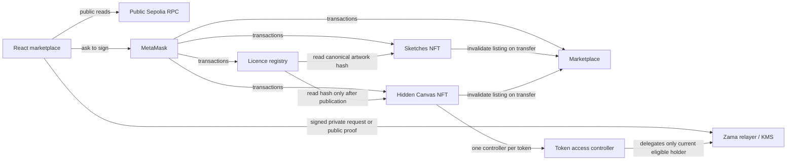
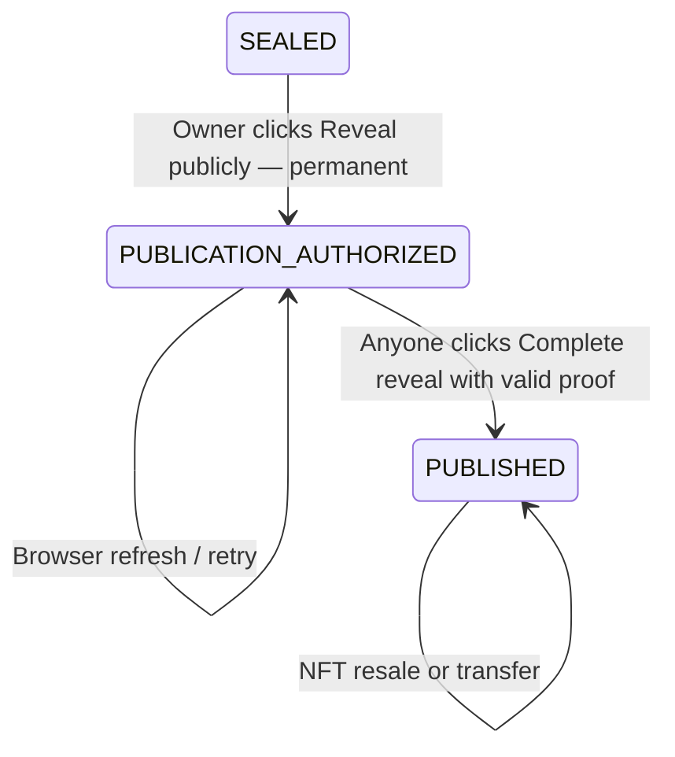

# CryptX: complete project walkthrough

This document explains the contracts, frontend, completed Sepolia interactions and remaining limits as of **18 October 2026**. Start with the [README](../README.md) for a quick run command or [new-device setup](SETUP_NEW_DEVICE.md) for transfer instructions.

## 1. What the project is, and its current status

CryptX is a React website connected to four Solidity contracts on **Ethereum Sepolia** (chain ID `11155111`). The contracts' original on-chain names and the `canvas-market` manifest identifier remain as deployed:

| Piece | Purpose | Deployed address |
| --- | --- | --- |
| Sketches | Ten ordinary ERC-721 artworks, all minted to creator Account A during deployment; no later mint function | [`0xE98bEd0943A1fc22296E1bBfafca30660a3b6508`](https://sepolia.etherscan.io/address/0xE98bEd0943A1fc22296E1bBfafca30660a3b6508) |
| Hidden Canvas | Up to 20 paid ERC-721 mints; each starts with a Zama-generated encrypted artwork seed | [`0x8a2d41319C8bF12Cc86a10C2499d195a9dF47a84`](https://sepolia.etherscan.io/address/0x8a2d41319C8bF12Cc86a10C2499d195a9dF47a84) |
| Marketplace | Owner-signed, fixed-price listings and purchases in Sepolia ETH | [`0xc6209DBeF278159DAeb383414C34266D65ec1252`](https://sepolia.etherscan.io/address/0xc6209DBeF278159DAeb383414C34266D65ec1252) |
| ArtworkLicenseRegistry | Project-specific educational artwork licence and non-transferable receipts | [`0x8a465728f97EEc5062Ed57E46B5659Cfbd7d9E13`](https://sepolia.etherscan.io/address/0x8a465728f97EEc5062Ed57E46B5659Cfbd7d9E13) |

Creator/seller **Account A** was `0xa128D37463b7233c7338d6Aef0dd5c347BFdcC70`; buyer/licensee **Account B** was `0x9A884d981f512f77c92B95BDB92206A0AA043Fc9`. These are *public addresses*, not keys. The exact six deployment transactions and configuration are in [the public manifest](../deployments/sepolia-marketplace.json). Deployment transactions were compared with compiled constructor bytecode, and the resulting contracts were read on Sepolia. That is distinct from claiming a source-code verification badge on Etherscan.

**Current status:** The coursework contracts, deployment, two-wallet demonstration, tests and CryptX frontend are complete. The site runs locally, not on a public host. Sketches metadata and the sealed placeholder point to `127.0.0.1:5173`, so another person's device or a third-party NFT marketplace cannot reliably load those URLs. The contracts are unaudited and this is not production software.

## 2. How to see the current website

From the project folder on the machine where it was built:

```sh
cd /path/to/BlockChain
nvm use
npm ci
npm --prefix frontend ci
npm run compile
npm --prefix frontend run dev
```

Open **http://127.0.0.1:5173/** in the browser. A visitor can browse public Sepolia state without connecting a wallet. Connect a throwaway Sepolia MetaMask account only for signing transactions or accessing wallet-specific views. Port 5173 must be available because the deployed NFT metadata uses it. `127.0.0.1` refers to *your own computer*; this is not a public website URL. Running Vite serves the website and local artwork/metadata files; it does not deploy any new contract or charge gas.

The frontend is React 19, Vite 7, TypeScript, ethers v6 and the pinned Zama browser SDK. Hardhat compiles/tests Solidity 0.8.27. The root and frontend have separate `package-lock.json` files, so `npm ci` installs the tested dependency versions in each location.

## 3. From the empty folder to the live demo

1. **Toolchain and API check.** Node `22.23.3`, Solidity `0.8.27`, ethers v6 and the pinned Zama Hardhat/browser SDK versions were selected and tested together. The project retains [Zama's template licence notice](../ZAMA_TEMPLATE_LICENSE).
2. **Small privacy experiment before the marketplace.** [`SeedFeasibility.sol`](../contracts/SeedFeasibility.sol), a simple seed registry, and [`TokenAccessController.sol`](../contracts/TokenAccessController.sol) tested Zama randomness, delegated owner preview, access rejection, transfer revocation and public proof verification. This experimental contract is **not an ERC-721** and is not the final marketplace NFT. Its source and tests remain for reference; its standalone browser page has been removed.
3. **First experiment and browser fix.** The first experiment at `0x49F94F6b8d579a43f5C9ebEc3146D4303987f54D` remains on Sepolia. A Vite error occurred because source code attempted to import a JS file from Vite's `public/` directory. The browser import was corrected to `@zama-fhe/relayer-sdk/web`; only WASM/worker assets are served from `public/vendor/zama/`. Existing blockchain transactions could not be erased, so a fresh experiment was deployed.
4. **Successful fresh experiment.** Account A deployed `0x99cAf56Dd62f00c7355f0AFa8bb3985bC720f69E`; A and B minted separate seeds. The full 96-block waiting period was used. A privately previewed token 1 twice; unauthorized B and former-owner A received explicit relayer rejection, not merely a timeout. A cross-token request failed at the client ACL precheck. After transfer, B reactivated and saw the same painting. Public reveal and interrupted-reveal completion worked.
5. **Full contracts and original artwork.** The project includes ten original local Sketches SVGs, a deterministic Hidden Canvas SVG renderer, the two ERC-721 collections, the shared marketplace and the educational licensing registry. The ten Sketches' exact SVG hashes are stored in their collection. Hidden Canvas's renderer is versioned and checked for exact Solidity/frontend output parity on selected seeds.
6. **Frontend and deployment.** The marketplace page includes wallet flows, private preview, recoverable reveal, fixed-price trade, licensing and balances. Account A used MetaMask for six Sepolia transactions: deploy four contracts, then link both collections to the marketplace. The first Sketches deployment minted all ten NFTs to A. The manifest importer checked the receipts, constructor arguments, links, fees and artwork hashes.
7. **Two-wallet end-to-end demonstration.** A listed Sketches #1 for `0.0001` Sepolia ETH; B bought it and later relisted it at `0.0008`. A minted Hidden Canvas #1 and #2 at `0.001` Sepolia ETH each. B's fresh request for A's sealed #1 was rejected. After 96 blocks, A activated and privately previewed #1 twice, listed it while sealed, and B bought it. A's new request was rejected after ownership changed. After a *new* 96-block delay, B activated and privately saw the same painting. B authorized and completed public reveal, sold the published NFT back to A for `0.0002`, and the artwork hash stayed the same. Separately, A authorized #2, refreshed the browser, and completed its proof later. B obtained a Sketches #2 licence and a published Hidden Canvas #2 licence. A withdrew sale, mint and licence proceeds separately. Private painting comparisons were observed by the wallet holder; no unrevealed seed or signature was saved.
8. **Checks and evidence.** Solidity tests, Playwright browser tests, typechecking and the production frontend build passed. A read-only SDK check publicly decrypted the two published Hidden Canvas tokens and confirmed proof presence and equality with their on-chain verified values, without printing seed values. The [public manifest](../deployments/sepolia-marketplace.json) records deployment receipts.

## 4. The parts and how they talk to each other



The NFT contracts own token state. The marketplace owns sale listings and seller balances. The licensing registry owns licence receipts and creator licence balances. A sale transfers the NFT but does **not** transfer copyright or the creator's licensing authority. The browser displays and signs actions; it is not trusted to enforce ownership or proof validity. The contracts enforce those rules.

### Three meanings that are easy to confuse

- A **MetaMask wallet seed phrase/private key** controls the account. The website never needs an exported key or phrase.
- A **Hidden Canvas artwork seed** is a Zama-generated encrypted `uint64` at mint. It determines the painting. Before reveal, eligible owners can learn it privately through a signed request; after authorization, it is intentionally public.
- A **Sepolia RPC URL** is a network endpoint for reading/broadcasting public blockchain data. It is not a private key. The project's read-only endpoint is a public URL.

## 5. Every explicit Solidity function: access controller and Sketches

[`TokenAccessController.sol`](../contracts/TokenAccessController.sol) is deployed once **per Hidden Canvas token**, giving each controller access to only that token's ciphertext. The experiment uses the same controller design.

| Function or modifier | What it does and who can call it |
| --- | --- |
| `constructor()` | Records the deploying collection contract as the immutable `collection`. A wallet cannot later appoint itself as controller owner. |
| `onlyCollection` | Modifier that rejects calls unless the calling address is that original collection contract. |
| `activate(holder)` | Only the collection calls this after its owner/maturity checks. It creates a revocable Zama user-decryption delegation for that holder in the collection's context; it rejects a second active holder. This is **not** permanent `FHE.allow` permission to the wallet. |
| `revoke()` | Only the collection calls this. It removes the active holder's delegation and clears `activeHolder`; if nobody is active it is a no-op. An ACL failure propagates, so a transfer that requires revocation reverts atomically. |

[`SketchesNFT.sol`](../contracts/SketchesNFT.sol) is the ordinary collection:

| Function | What it does |
| --- | --- |
| `constructor(creator, metadataBaseURI, assetHashes)` | Rejects invalid setup, stores creator and ten exact artwork hashes, and safely mints token IDs 1–10 to the creator. There is no later mint function. |
| `setMarketplace(candidate)` | Creator-only, one-time link to a deployed marketplace that confirms it allows this collection. This permits trusted listing invalidation on transfers. |
| `totalSupply()` | Always returns 10. |
| `mintingClosed()` | Always returns `true`; the collection cannot be publicly minted again. |
| `artworkHash(tokenId)` | Returns the stored SHA-256 hash of the original SVG bytes for an existing token. The licensing registry uses this as the content reference. |
| `canList(tokenId)` | Returns `true` for an existing Sketches NFT; the marketplace still checks actual ownership and approval. |
| `tokenURI(tokenId)` | Returns the configured metadata URL plus `<tokenId>.json`; in this deployment it points to the local Vite server. |
| `_update(to, tokenId, auth)` | Internal OpenZeppelin ERC-721 transfer/mint hook. On any post-mint transfer, including a self-transfer, it asks the linked marketplace to invalidate the old listing. If that callback fails, the transfer reverts. |

## 6. Every explicit Solidity function: Hidden Canvas and artwork

[`HiddenCanvasNFT.sol`](../contracts/HiddenCanvasNFT.sol) is the final encrypted ERC-721 collection. Its `Secret` record holds one token's controller, encrypted handle, eligibility block, ownership epoch, publication stage and public value only after verified completion. Sepolia requires exactly **96 blocks** of maturity, both after mint and after a real ownership change. A block count is not a promised number of minutes.

| Function | What it does |
| --- | --- |
| `constructor(creator, mintPrice, activationDelayBlocks)` | Allows Sepolia or local Hardhat only, checks a real creator and positive price, and enforces `96` blocks on Sepolia. Saves immutable setup values. |
| `setMarketplace(candidate)` | Creator-only, one-time link to an approved marketplace so transfers can invalidate listings. |
| `mint()` | Public payable mint with exact fee and 20-token cap. Increments supply and mint proceeds, deploys a fresh per-token controller, calls `FHE.randEuint64()` for an encrypted random seed, permits only the collection and that controller to access its handle, sets epoch 1 and a 96-block eligibility point, and mints the ERC-721 to the payer. No user or server chooses the seed. |
| `state(tokenId)` | Returns public state: current owner, controller, ciphertext handle, eligibility block, epoch, publication stage and published value. The handle is not plaintext. Before completion the `revealed` field is not a usable private seed. |
| `activatePrivatePreview(tokenId, expectedEpoch)` | Only the current owner, at or after eligibility, in the sealed stage, can tell the token's controller to grant delegated private-decryption access. The epoch blocks a stale request after a transfer. |
| `authorizePublicReveal(tokenId, expectedEpoch)` | Only the eligible current owner can call this once, and only while the NFT is unlisted and sealed. It revokes private delegation, sets `PUBLICATION_AUTHORIZED`, and calls `FHE.makePubliclyDecryptable`. **The seed becomes public at this transaction**, even if the browser closes before proof completion. |
| `completeReveal(tokenId, clearSeed, proof)` | Callable by **anyone** after authorization. It takes the token's *stored* encrypted handle, verifies the Zama proof against that handle and the encoded `uint64` value, then stores the verified public value and marks the token `PUBLISHED`. A bad proof/value or repeated completion reverts. The caller cannot substitute another token's handle. |
| `canList(tokenId)` | Allows listings only while `SEALED` or `PUBLISHED`; the proof-pending middle stage cannot be listed. |
| `artworkHash(tokenId)` | Available only once published. Returns a hash of the fixed renderer version and verified public seed, so a licence remains bound to the same painting after resale. |
| `tokenURI(tokenId)` | Before completion returns generic metadata and the sealed placeholder, with no private painting or traits. After completion generates an on-chain base64 SVG and public rarity/traits/seed. During proof-pending state it still shows the placeholder, but the seed is **already publicly decryptable**. |
| `withdrawMintProceeds()` | Only the fixed creator can withdraw accumulated mint fees. It zeroes accounting before sending ETH and uses a reentrancy guard. |
| `_eligible(tokenId, secret, expectedEpoch)` | Private common check for actual current owner, current ownership epoch and maturity block. An approved transfer operator is not treated as owner. |
| `_update(to, tokenId, auth)` | Internal ERC-721 ownership hook. On a real owner change it revokes active private delegation if sealed, increments the epoch and restarts the 96-block wait. Any post-mint transfer invalidates a listing, including self-transfer. A self-transfer leaves epoch, maturity and delegation unchanged. |

[`CanvasArt.sol`](../contracts/CanvasArt.sol) is a deterministic renderer library. The frontend counterpart is [`art.ts`](../frontend/src/lib/art.ts). The same `uint64` must give the same SVG in both places.

| Function | What it does |
| --- | --- |
| `rarity(seed)` | Reads the highest byte and selects Common, Rare, Exceptional or Singular by fixed ranges. |
| `paletteName(seed)` | Chooses one of eight public palette names from the next byte. |
| `motionName(seed)` | Chooses one of four shape styles from a later byte. |
| `motifCount(seed)` | Chooses 8–16 shapes. |
| `palette(seed)` | Returns the four exact colors for the selected palette. |
| `renderSvg(seed)` | Builds the canonical 640×640 SVG from traits and repeated shape geometry. |
| `_geometry(state)` | Private helper deriving a motif's position, size and tilt. |
| `_next(value)` | Private deterministic 64-bit state step; this is **art generation**, not mint randomness. Mint randomness comes from Zama FHE. |
| `_shape(motion, index, geometry, fill)` | Private helper that renders a rectangle, ellipse, curved path or folded polygon. |
| `_half(doubled)` | Private helper for exact integer/half coordinates in SVG strings. |
| `_opacity(index)` | Private helper for repeated opacity values. |

The renderer keeps large values as Solidity `uint64`/`uint256` or JavaScript `bigint`; it does not convert a 64-bit seed to an unsafe JavaScript `Number`. The ten Sketches SVGs come from [`generate-sketches.mjs`](../scripts/generate-sketches.mjs).

## 7. Every explicit Solidity function: marketplace and licensing

[`NFTMarketplace.sol`](../contracts/NFTMarketplace.sol) accepts only the two collection addresses set in its constructor. Listings are **non-escrow**: the seller retains the NFT until a buyer pays. The owner must first approve the marketplace in the ERC-721 contract; that is why listing can produce two MetaMask transactions.

| Function | What it does |
| --- | --- |
| `constructor(sketches, hiddenCanvas)` | Requires two distinct deployed ERC-721 collections and fixes them permanently. |
| `isCollectionAllowed(collection)` | Tells a collection whether it is one of those two allowed addresses. |
| `isListed(collection, tokenId)` | Returns whether a listing is currently active; Hidden Canvas uses this before authorizing a reveal. |
| `list(collection, tokenId, price)` | Requires linked allowed collection, positive price, listable token, actual owner and marketplace approval. Saves seller/price/current version; the wallet owner signs this transaction. |
| `cancel(collection, tokenId)` | Only the listing seller can clear an active listing; increments the version. |
| `buy(collection, tokenId, expectedVersion)` | Rejects old listing versions, self-purchase, wrong payment, changed ownership/approval and non-listable tokens. Clears the listing, credits seller proceeds, then safely transfers the ERC-721. A malicious receiver callback cannot buy the same listing again. |
| `invalidateFromCollection(tokenId)` | Only a fixed collection contract may call this. Clears its token's listing and increments the version whenever that NFT transfers directly or through the marketplace. |
| `withdrawProceeds()` | A seller pulls only their own credited Sepolia ETH. The balance is zeroed before payment; a failed payment reverts and preserves it. |
| `_validateCollection(collection)` | Private check that the address is one of the fixed collections and that it linked this marketplace. |
| `_approved(collection, tokenId, owner)` | Private check for token-specific or operator approval of the marketplace. |

[`ArtworkLicenseRegistry.sol`](../contracts/ArtworkLicenseRegistry.sol) implements a **project-specific educational licence**, not a Story/DATA integration or copyright registration. It has fixed v1 terms, a fee of `0.0001` Sepolia ETH, one receipt per wallet/artwork, and no receipt transfer function. The creator receives the fee even if someone else owns the NFT.

| Function | What it does |
| --- | --- |
| `constructor(sketches, hiddenCanvas, licenceFee)` | Fixes the two eligible collections and a positive fee. |
| `termsHash()` | Returns the hash of the fixed text in `TERMS`; issued receipts retain this version/hash. |
| `licenseCount(licensee)` | Returns how many receipts that wallet has. |
| `licenseReceiptIdAt(licensee, index)` | Gives an indexed receipt ID for the wallet's receipt list. |
| `obtainLicence(collection, tokenId)` | Requires an allowed collection, exact fee and no previous receipt for that wallet/artwork. Reads the artwork hash and fixed creator, stores an immutable-content receipt with terms version/hash and issuance time, and credits the creator. Sketches works immediately; sealed Hidden Canvas reverts at `artworkHash` until publication is complete. |
| `withdrawLicenceProceeds()` | Lets the credited creator withdraw their own licence fees using zero-before-send and reentrancy protection. |

[`IProjectCollection.sol`](../contracts/interfaces/IProjectCollection.sol) contains two interfaces rather than deployed contracts. `IListingInvalidator` declares `invalidateFromCollection`, `isListed`, and `isCollectionAllowed` so collections can talk to the marketplace. `IProjectCollection` declares `canList`, `artworkHash`, `creator`, and `marketplace` so marketplace/licensing code can talk to either collection. An interface declares the expected call shape; the actual behavior is in the contracts above.

OpenZeppelin supplies standard ERC-721 methods such as `ownerOf`, `balanceOf`, `approve`, `getApproved`, `setApprovalForAll`, `isApprovedForAll`, `transferFrom`, and `safeTransferFrom`. Solidity also generates read-only getter functions for `public` values and mappings such as `totalSupply`, `creator`, `listings`, `proceeds`, and `receipts`; those getters expose the stored state but do not add custom business logic. The project-specific overrides and functions are explained above.

## 8. The separate experiment contract, function by function

[`SeedFeasibility.sol`](../contracts/SeedFeasibility.sol) was the early privacy gate. Its seed records resemble Hidden Canvas records, but it has **no ERC-721**, marketplace, payments or licences. It should not be mistaken for the finished application.

| Function | What it tested |
| --- | --- |
| `constructor(delay)` | Enforces Sepolia/local chain and 96 blocks on Sepolia. |
| `mint()` | Creates one of at most 20 encrypted random seeds and a separate controller; records owner, epoch and maturity. |
| `state(id)` | Reads public owner/controller/handle/maturity/epoch/publication information. |
| `activate(id, expectedEpoch)` | Eligible current owner activates delegated private preview while sealed. |
| `transfer(id, to)` | Experiment-only ownership transfer: rejects bad recipients, revokes old delegation, increments epoch and restarts maturity. Self-transfer leaves access and maturity intact. |
| `authorize(id, expectedEpoch)` | Eligible owner revokes private delegation and permanently makes the ciphertext publicly decryptable. |
| `finalize(id, clearSeed, proof)` | Anyone with a valid proof can publish the verified value using this seed's stored handle. |
| `_eligible(seed, expectedEpoch)` | Internal current-owner, epoch and maturity check. |

Test-only harnesses in `contracts/test/` are **not** the four deployed application contracts:

| Test contract / function | Why it exists |
| --- | --- |
| [`CanvasArtHarness.renderSvg(seed)`](../contracts/test/CanvasArtHarness.sol) | Exposes the internal Solidity renderer to a local test so its exact SVG can be compared with frontend output. |
| [`RejectEtherSeller.onERC721Received`, `link`, `list`, `withdraw`, `receive`](../contracts/test/AdversarialActors.sol) | Acts as a seller contract that can hold/list an NFT but rejects incoming ETH. Tests that failed pull-withdrawal does not lose its credited balance. |
| `ReenteringBuyer.constructor`, `setTarget`, `buy`, `onERC721Received`, `receive` | Acts as a buyer whose ERC-721 receive callback tries to purchase the same target again. Tests that the marketplace's state changes and reentrancy guard block a duplicate purchase. |

## 9. Why the reveal has two buttons, and how recovery works



The two transactions cannot simply happen in reverse: Zama public decryption needs the **first confirmed transaction** to make the encrypted handle publicly decryptable. The first button is the irreversible privacy decision. The browser then requests a public value **and proof** from the SDK. The second button sends them to `completeReveal`, whose on-chain proof check binds them to that token's stored handle. A UI could later guide both steps in one click sequence, but the blockchain still requires the two ordered stages and a confirmed first transaction.

If the browser closes after authorization, the chain still says `PUBLICATION_AUTHORIZED`. Reopen the NFT, connect a Sepolia wallet and click the **existing “Complete reveal”** button; there is no separate “Recover” button. The contract allows anyone to supply the valid proof, although the website asks for a connected wallet because finalization is a transaction. If proof retrieval or that transaction fails, retry `Complete reveal`; do not click permanent authorization again. Hidden Canvas #2 passed this exact refresh-and-resume test: [authorization](https://sepolia.etherscan.io/tx/0x8525d43d9761becd23865d1061de66c619c9ec3bb651582533a988ac9bbf2ea4), then [later completion](https://sepolia.etherscan.io/tx/0x2816affc732e921a38ddc3caf839aff08d91ed67471e995720bdb1d6d9cc632e).

**Do not call the middle stage private.** The public metadata still displays a placeholder while proof is pending, but the seed is already publicly decryptable from the first transaction. Published art and rarity appear only after the valid proof is checked and the final value stored.

## 10. Frontend and file map

| File / function group | Job |
| --- | --- |
| [`frontend/src/market/chain.ts`](../frontend/src/market/chain.ts): `checkedManifest`, `checkedDraft` | Validates public deployment information, including Sepolia chain and 96-block delay; rejects wrong/malformed deployments. |
| `readProvider`, `walletProvider`, `connectedWallet`, `contracts` | Builds a public read-only Sepolia provider, checks MetaMask's chain, requests the wallet account and creates ethers contract instances from compiled ABIs. |
| `confirmed` | Waits for a transaction receipt and requires success status; a transaction hash alone is not treated as success. |
| `deployMarket` and its `validateReceipt`, `deployOne`, `linkOne` helpers | Runs the six MetaMask deployment/link transactions, stores safe public progress for refresh recovery, checks receipts and exact creation data, and returns a manifest. |
| [`frontend/src/market/model.ts`](../frontend/src/market/model.ts): `readSketch`, `readHidden`, `readListing`, `readMarket` | Reads and verifies the actual Sepolia items, state, listings, licence receipts, fees and balances. A sealed token gets a placeholder, not a private image. |
| `readInGroups`, `amount`, `short` | Limits batched RPC requests, formats Sepolia ETH, and shortens displayed addresses. |
| [`frontend/src/market/main.tsx`](../frontend/src/market/main.tsx): `savedManifest`, `savedDraft`, `download`, `marketError` | Loads/downloads only public deployment data and maps errors to safer user-facing messages. |
| `App`, `refresh`, `run`, `connect`, `send`, `withSigner` | Manages navigation and wallet state, refreshes Sepolia state, serializes actions, asks MetaMask to sign, checks receipts, and clears private preview when context changes. |
| `importManifest`, `deploy` | Reads a manifest from file or deploys via MetaMask, then verifies on-chain state and saves only public data. |
| `freshPrivatePreview`, `probeNonOwnerAccess` | Uses a fresh signed SDK request for a current owner's private painting; the negative probe counts outbound requests and discards any unexpected plaintext. Ownership is checked again after decryption. |
| `completeReveal`, `list`, `buy`, `detail` | Obtains the public proof and finalizes reveal; performs explicit approval/listing, checks listing version before purchase, and renders item actions. |
| [`frontend/src/lib/zama.ts`](../frontend/src/lib/zama.ts): `initializeBrowserSdk`, `freshInstance`, `freshPreview`, `classify` | Loads Zama WASM, creates a fresh SDK instance, signs a delegated private-decryption permit through MetaMask, and labels explicit ACL rejection separately from an inconclusive timeout. The permit is not an on-chain delegation. |
| [`frontend/src/lib/art.ts`](../frontend/src/lib/art.ts): `traits`, `renderSvg`, `imageUrl` | Converts a verified/private `bigint` seed into the same deterministic traits and SVG as the Solidity renderer. |
| [`scripts/generate-sketches.mjs`](../scripts/generate-sketches.mjs) | Reproducibly generates the ten SVGs, metadata files, catalog and exact-byte hashes. |
| [`scripts/sync-market-frontend.mjs`](../scripts/sync-market-frontend.mjs), [`scripts/sync-zama-assets.mjs`](../scripts/sync-zama-assets.mjs) | Copies compiled marketplace ABIs/bytecode, the verified public manifest, catalog and local SDK assets into Vite before dev/build. |
| [`scripts/import-market-manifest.mjs`](../scripts/import-market-manifest.mjs) | Imports downloaded **public** marketplace deployment JSON after checking Sepolia receipts, code, constructor data and configured state. It does not sign transactions. |

The app polls public state and clears any private preview if the account, chain, token, owner, epoch or publication context changes. Private seed values stay in page memory. A previous holder can still remember or save art already seen—the contract cannot erase human knowledge.

## 11. Why no private key, custom RPC URL or `.env` file is needed

Every deployment, mint, listing, purchase, licence and withdrawal was submitted through **MetaMask**. MetaMask signs internally and gives the website a public account/provider interface. Exporting a key into a project file is unnecessary. No `.env` file is needed for local viewing or wallet-driven transactions.

| Optional process variable | Current role | Why it is unnecessary for the website |
| --- | --- | --- |
| `SEPOLIA_RPC_URL` | Read by [`hardhat.config.ts`](../hardhat.config.ts) **only if a future Hardhat command uses its Sepolia network**. It has a public PublicNode fallback. | Browser deployment used MetaMask; marketplace read-only calls use `PUBLIC_RPC` in `frontend/src/market/chain.ts`. No private RPC credential was needed. |
| `DEPLOYER_PRIVATE_KEY` | Optional Hardhat CLI signer if explicitly supplied to the process. | MetaMask handled all signed transactions. **Never paste a wallet key into the frontend.** |

`hardhat.config.ts` reads `process.env`, but this repository **does not automatically load a root `.env` file**. A future CLI deployment would need deliberately supplied process environment values or a separately reviewed dotenv loader. The current app has no CLI deployment script requiring them. The creator address came from the MetaMask deployer and is stored on-chain; the 96-block delay is also enforced on-chain. `VITE_*` variables would be included in public browser code, so secrets must never go there. The public RPC URL can change if a provider stops working, but it is not a secret. Zama's relayer/KMS endpoints are configured by the installed Sepolia SDK configuration.

The public address/receipt manifest is safe to share. A MetaMask **signature**, private key, wallet seed phrase and an unrevealed artwork seed should not be pasted into chat or documentation. Once an artwork has been publicly authorized, its seed is public by design.

## 12. CryptX: the finished dark-mode website redesign

The marketplace website is now **CryptX**, while the deployed contract names and `canvas-market` manifest identifier remain as they were on Sepolia. It uses a dark NFT-gallery visual direction inspired by marketplace browsing, **without copying OpenSea's logo, images or exact interface**. The original C/X mark is [`cryptx-mark.svg`](../frontend/public/cryptx-mark.svg); the theme and responsive layout are in [`style.css`](../frontend/src/market/style.css).

What changed:

1. Near-black/navy background, lighter cards and panels, high-contrast headings, muted secondary text and blue action buttons with visible hover/focus states.
2. A compact header with the new wordmark and logo, Explore/Sketches/Hidden Canvas/My NFTs/Licences navigation, searchable artwork names/collections, Sepolia indicator and MetaMask button.
3. A smaller featured collection hero, collection shortcuts, image-led NFT cards, a listed-only filter, and clear fixed-price versus status labels. Sealed tokens still use their public placeholder; private art never appears in a public card.
4. A two-column desktop NFT detail view with artwork, price/owner actions, publication state, traits and licence terms. The public reveal warning and recoverable `Complete reveal` action retain their behavior.
5. Responsive mobile navigation and two-column cards, with no document overflow in the checked 390px layout. The browser still clears private previews on wallet, chain and ownership changes.
6. The frontend build and browser tests passed; live public Sepolia browsing showed 12 artworks, including two published Hidden Canvas tokens. Search returned the two Hidden Canvas items; the listed-only filter correctly returned none for them. No new deployment or private key was needed.

## 13. Remaining limits

- The contracts are unaudited. Local mocks and browser tests do not prove live confidentiality; the Sepolia demonstration exercised the deployed contracts separately. A relayer timeout is inconclusive, while an explicit ACL label can support a denial finding.
- Delegation can be revoked for future decryptions, but an earlier owner can keep any plaintext or image already seen.
- The pinned Zama SDK and relayer may change. Upgrades require a compatibility and live-access check.
- There is no public hosting or stable metadata domain. Third-party marketplace compatibility, mainnet deployment and legal copyright protection have not been established. The licence receipt records demo terms; it cannot physically prevent copying.

